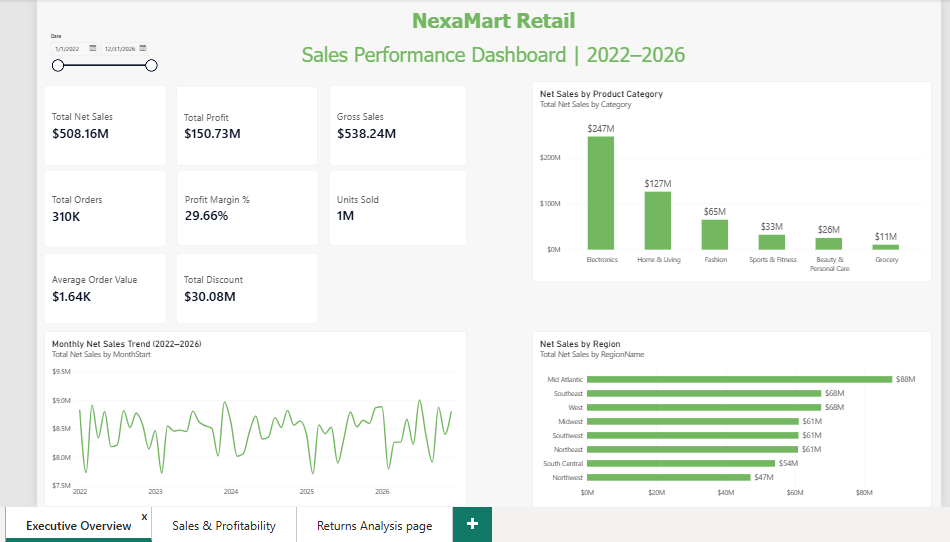
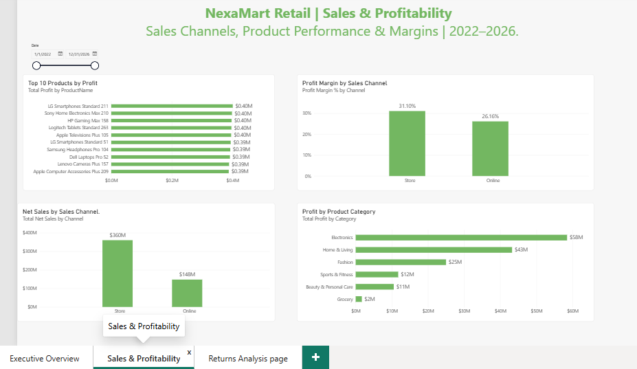
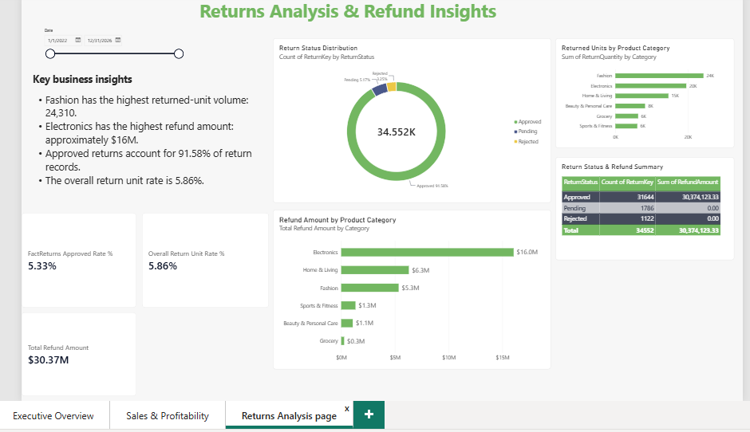

# Sales Performance & Business Analytics Dashboard
## Project Overview

This project analyzes retail sales, profitability, customer behavior, store performance, promotions, and product returns using SQL Server, Microsoft Excel, and Power BI.

Using a synthetic retail dataset with over 574,000 sales records, the project transforms raw data into meaningful business insights that support performance monitoring and better decision-making.

Dataset notice: This project uses synthetic, fictional retail data created for portfolio and analytics practice. It does not represent the actual performance of a real business.

## Dashboard Preview

### Executive Overview

### Sales & Profitability

### Returns Analysis

## Tools & Technologies

- **SQL Server:** Data storage, querying, data quality checks, and business analysis
- **Microsoft Excel:** Data analysis, summary tables, and charts
- **Power BI:** Interactive dashboards and KPI reporting
- **DAX:** Measures and business performance calculations
- **Power Query:** Data preparation and transformation

## Key Performance Indicators

| KPI | Result |
|---|---:|
| Completed Orders | 310,200 |
| Customers with Completed Sales | 25,000 |
| Active Stores | 75 |
| Units Sold | 1,349,700 |
| Gross Sales | $538.24M |
| Total Discounts | $30.08M |
| Net Sales | $508.16M |
| Total Profit | $150.73M |
| Profit Margin | 29.66% |
| Average Order Value | $1,638.18 |
| Approved Refunds | $30.37M |

## Business Insights

### Sales & Profitability
- Total net sales reached approximately $508.16 million.
- Overall profit margin was 29.66%.
- Electronics generated the highest net sales among product categories.
- Beauty & Personal Care recorded the highest category profit margin at 41.18%.

### Store & Channel Performance
- Store sales generated approximately $360.35 million in net sales.
- Online sales generated approximately $147.81 million in net sales.
- Store sales had a higher profit margin than online sales in this dataset.

### Discounts & Promotions
- Sales without discounts had a 33.64% profit margin.
- Sales with discounts of 20% or more had a 7.29% profit margin.
- High-discount promotions should be reviewed to understand their effect on profitability.

### Returns Analysis
- The dataset contains 34,552 return records across all statuses.
- Approved refunds total approximately $30.37 million.
- Fashion had the highest period-level approved return rate at 8.21%.
- Electronics accounted for the largest approved refund amount by category.

*Return rates compare units sold during the order period with approved returned units during the return period. They are not order-level cohort return rates.*

## Data Model

The project uses a relational retail analytics database built in SQL Server.

### Dimension Tables
- `DimDate` — date attributes for time-based analysis
- `DimProduct` — product names and categories
- `DimCustomer` — customer information
- `DimStore` — store information
- `DimRegion` — regional grouping
- `DimEmployee` — employee information
- `DimPromotion` — promotion details

### Fact Tables
- `FactSales` — sales transactions, quantities, discounts, costs, net sales, and profit
- `FactReturns` — returned quantities, return statuses, and refund amounts

The data model supports analysis across products, customers, stores, regions, employees, promotions, and time periods.

## SQL Analysis

The `SQL/` folder contains 15 SQL scripts covering:

1. Database inspection
2. Data quality checks
3. Category performance
4. Regional performance
5. Monthly sales trends
6. Channel performance
7. Top products by profit
8. Promotion performance
9. Returns analysis
10. Customer performance
11. Employee performance
12. Store performance
13. Approved return rate by category
14. Discount and profitability analysis
15. Final project KPI summary

## Project Files

- `Sales_Performance_Business_Analytics.pbix` — Power BI dashboard
- `Sales_Performance_Business_Analytics.pdf` — Exported dashboard report
- `EXCEL/NexaMart_Sales_Analysis.xlsx` — Excel analysis workbook
- `SQL/` — SQL scripts
- `screenshots/` — Dashboard screenshots

## Dashboard Pages

The Power BI report contains three pages:

1. Executive Overview
2. Sales & Profitability
3. Returns Analysis

The report includes KPI cards, category and channel comparisons, regional performance, monthly trends, profitability analysis, return status summaries, and a shared date slicer.

## Skills Demonstrated

- SQL querying and aggregation
- Data quality validation
- Business and sales analysis
- KPI development
- Profitability and margin analysis
- Customer and store performance analysis
- Data visualization and dashboard design
- Excel reporting
- Business insight communication

## Disclaimer

This is an independent portfolio project built for learning and demonstration purposes. All retail data is synthetic and fictional.

## Contact

Ghulam Murtaza | [LinkedIn](https://www.linkedin.com/in/ghulam-murtaza-a1319b435)
